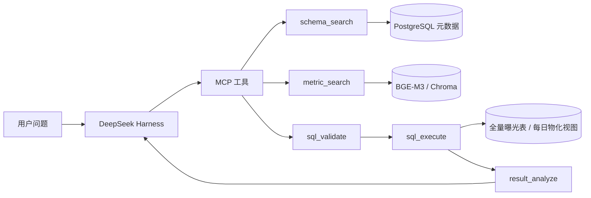

# Criteo 广告数据分析 Agent

基于 Criteo 真实曝光数据构建的本地广告分析系统，结合 PostgreSQL、BGE-M3、Chroma 和 MCP，为 DeepSeek Harness 提供字段查询、指标检索、安全 SQL 查询与结果分析能力。

当前部署已导入 **16,468,027 条曝光记录、675 个 campaign**，覆盖 **31 个相对数据日**。每日计划物化视图包含 **20,665 行**。项目文档统一维护在本 README。

## 功能与架构

- 每批处理 100,000 行，通过 COPY 导入中间表；校验完整后，在事务内替换原始表并刷新物化视图。
- 使用二进制摘要核对来源、中间表和最终表的全部 23 列及行序；保留原 20 万条样本备份。
- 表名和字段从 PostgreSQL 实时元数据获取；指标定义与业务规则由 BGE-M3 / Chroma 检索。
- SQLGlot 校验单条 SELECT、白名单表、字段、函数和 LIMIT；独立只读账号执行查询并限制资源。
- 查询结果以结构化记录和可引用的上下文返回给 Agent。



## 目录

```text
.
├── ad_agent/                    # MCP 服务、目录查询、SQL 校验与执行
│   ├── mcp_server.py
│   ├── catalog.py
│   ├── tools.py
│   ├── sql_policy.py
│   ├── sql_tools.py
│   └── harness-mcp.patch.yml     # 新环境的 MCP 配置示例
├── database/                    # 建表、导入、数据库启动与验证
│   ├── schema.sql
│   ├── views.sql
│   ├── db.py
│   ├── readonly.py
│   ├── setup_postgres.py
│   ├── setup_readonly.py
│   ├── import_sample.py
│   ├── import_full.py
│   ├── verify_full.py
│   ├── postgres_paths.py
│   ├── Start-Postgres.ps1
│   └── Stop-Postgres.ps1
├── knowledge/                   # 字段、指标及业务规则
│   ├── table_schema.md
│   ├── metric_definitions.md
│   ├── business_rules.md
│   └── dataset_manifest.json
├── rag/                         # 模型下载、分块、建库和检索
│   ├── download_model.py
│   ├── embedding.py
│   ├── chunks.py
│   ├── metadata.py
│   ├── store.py
│   ├── build_index.py
│   ├── retrieve.py
│   └── settings.py
├── data/
│   ├── raw/                     # 原始 TSV.gz，本地保存
│   ├── interim/                 # 前 20 万条开发样本 Parquet
│   └── processed/               # 全量每日计划统计 Parquet
├── tests/                       # SQL 安全、MCP 协议和基准评测
├── Set-ProjectEnv.ps1
├── Start-Harness.ps1
├── requirements.txt
├── requirements.lock.txt
└── README.md
```

本地运行目录 `.venv/`、`.runtime/`、`.cache/`、`.tmp/`、`.dsh/` 和数据库 `pgdata/` 不提交 Git。模型权重、原始数据、派生 Parquet 和 Chroma 索引也不随源码上传。

## 数据与统计口径

来源：[Criteo 官方介绍](https://ailab.criteo.com/criteo-attribution-modeling-bidding-dataset/)、[Criteo 官方 Hugging Face 仓库](https://huggingface.co/datasets/criteo/criteo-attribution-dataset)。

原始文件为 `data/raw/criteo_attribution_dataset.tsv.gz`，包含表头和 22 个字段，压缩大小为 653,015,824 字节。SHA-256：

```text
94ac7a465564349bc7ba008602211d5990a3c53cc133abc0aadef61ea2391a98
```

数据许可为 [CC BY-NC-SA 4.0](https://creativecommons.org/licenses/by-nc-sa/4.0/)。使用和分发数据时应遵守官方条款；本仓库不附带原始数据或模型权重。

| 对象 | 内容 |
| --- | --- |
| `public.raw_criteo_impression` | 全量曝光表；22 个原始字段与本地生成的 `row_id`，共 23 列。 |
| `public.ads_campaign_daily` | 按 `data_day` 和 `campaign_id` 聚合的物化视图，共 8 列。 |
| `criteo_sample.parquet` | 保留的前 200,000 条顺序开发样本，不代表当前数据库范围。 |
| `campaign_daily.parquet` | 全量每日计划统计，按数据日和计划排序。 |

关键约定：

- 一行代表一次曝光。`campaign` 是原始广告计划 ID；视图中的 `campaign_id` 是其别名。
- `click` 是 0/1 标记，点击量为 `SUM(click)`；CTR 为 `SUM(click)::NUMERIC / NULLIF(COUNT(*),0)`。
- `conversion=1` 表示曝光后 30 天内存在转化。独立转化数需过滤 `conversion_id<>-1` 后去重，不能将正例曝光行数当作独立订单。
- 归因转化数还需满足 `attribution=1`。跨日或跨计划的去重转化数不能直接累加。
- `cost`、`cpo` 是转换后的数值，不是真实货币金额。缺少收入字段，无法计算真实 ROAS。
- `cat1`–`cat9` 是匿名上下文类别特征，具体业务含义未公开。
- `timestamp` 为相对秒数。`data_day=FLOOR(timestamp/86400.0)::INTEGER+1`，不能转换为真实日历日期。
- 当前时间范围为 0–2,671,199 秒，对应相对数据日 1–31；“最近七天”按数据轴解释，当前对应 25–31。

字段明细、指标公式和查询边界分别见 [table_schema.md](knowledge/table_schema.md)、[metric_definitions.md](knowledge/metric_definitions.md)、[business_rules.md](knowledge/business_rules.md)。

## 本地环境

当前部署使用 Windows x64、Python 3.11、Node.js 26、PostgreSQL 18.7。依赖版本见 [requirements.txt](requirements.txt) 与 [requirements.lock.txt](requirements.lock.txt)。

运行脚本约定以下本地目录；新环境需要自行安装或放置相应运行时：

```text
.runtime/python311/python.exe
.runtime/nodejs/node.exe
.runtime/nodejs/npx.cmd
.runtime/postgresql/pgsql/bin/
.runtime/postgresql/pgsql/lib/
.runtime/postgresql/pgsql/share/
```

PostgreSQL 二进制包从 [官方 Windows 下载入口](https://www.postgresql.org/download/windows/) 获取。Windows 中文路径兼容由 `database/postgres_paths.py` 的临时 ASCII 盘符映射处理，文件仍存放在项目目录，不注册系统服务。

在项目根目录打开 PowerShell：

```powershell
# 新环境首次创建虚拟环境；已有环境无需重复创建。
& '.\.runtime\python311\python.exe' -m venv .venv
. '.\Set-ProjectEnv.ps1'
python -m pip install -r requirements.txt
```

`Set-ProjectEnv.ps1` 设置当前终端的 Python、Node.js、PostgreSQL 路径及项目内缓存、临时目录和 Harness home。直接重装 lock 文件时，CPU PyTorch 需额外指定 `--extra-index-url https://download.pytorch.org/whl/cpu`。

### 首次准备数据库

1. 从官方来源下载原始数据，按上述文件名放入 `data/raw/`。
2. 执行 `python database/setup_postgres.py`，创建本地集群、导入账号和 `criteo_ads` 数据库。
3. 执行 `python database/import_sample.py`，验证前 20 万条管道并创建原始表。
4. 使用导入账号执行 `database/views.sql`，创建每日计划物化视图。
5. 执行 `python database/setup_readonly.py`，创建独立的 `criteo_reader` 账号。
6. 执行 `python database/import_full.py`，完成全量导入；然后运行 `python database/verify_full.py`。

已有全量部署不需要重新执行上述初始化，也不要再次追加样本数据。

导入账号与只读账号的随机凭据分别保存在 `database/connection.json`、`database/readonly_connection.json`；管理员凭据位于 `database/.secrets/`，均不提交版本管理。Python 连接统一通过 `database/db.py` 或 `database/readonly.py` 创建 SQLAlchemy engine。

全量导入流程为：来源 SHA-256 与 gzip 检查 → 10 万行分批验证/COPY → 中间表全字段摘要核对 → 备份旧样本 → 事务内替换原表、刷新视图 → 导出 Parquet。保留原表及视图的对象身份、依赖和只读授权。CTR 校验采用 `ROUND_HALF_UP`，与 PostgreSQL 舍入规则一致。

正常启动与停止：

```powershell
. '.\Set-ProjectEnv.ps1'
& '.\database\Start-Postgres.ps1'
& '.\Start-Harness.ps1'
# 停止数据库前先结束正在执行的查询：
& '.\database\Stop-Postgres.ps1'
```

全量流程支持在发布失败后复用已验证中间表：`python database/import_full.py --resume-validated`。此选项要求保留相应导入状态和中间表，不能用于任意半完成导入。

## RAG 检索

仅索引上述三个知识 Markdown，采用官方 `BAAI/bge-m3` 的 1024 维归一化稠密向量与 Chroma 余弦检索。当前使用 CPU；模型位于 `.runtime/models/bge-m3/`，下载版本与文件校验记录见 [model_manifest.json](rag/model_manifest.json)。

```powershell
. '.\Set-ProjectEnv.ps1'
python -m rag.download_model
python -m rag.build_index
python -m rag.retrieve 'CTR 是什么？使用哪个字段计算？'
```

当前索引为 23 个知识块，保存源文件、章节和行号。索引保存在 `rag/chroma/`；`rag/index_manifest.json` 记录文档哈希。知识文档修改后必须重建索引，检索会拒绝使用过期文档版本。

表结构以实时 PostgreSQL 元数据为准，不依赖向量匹配猜测字段。检索结果包含 `knowledge`、`database_metadata` 和 `agent_context`。Embedding 在本地运行，不调用在线生成模型。

## MCP 工具

统一入口：[ad_agent/mcp_server.py](ad_agent/mcp_server.py)。

| 工具 | 实现 | 输入与用途 |
| --- | --- | --- |
| `schema_search` | `catalog.py` | `query`、可选 `table_name`；查询 `information_schema.columns`，物化视图补查 `pg_catalog`。 |
| `metric_search` | `tools.py` | `query`、`top_k=3`；检索指标和业务规则，`top_k` 范围 1–5。 |
| `sql_validate` | `sql_policy.py` | `sql`；SQLGlot AST 校验及规范化。 |
| `sql_execute` | `sql_tools.py` | `sql`；实时二次校验后使用只读账号查询，返回真实 `rows` 和 `result_id`。 |
| `result_analyze` | `sql_tools.py` | `result_id`、`preview_rows=20`；整理真实缓存结果、列摘要和 `agent_context`，预览上限 100 行。 |

安全限制：

- 仅允许两个项目对象的单条 SELECT；支持受限的 CTE、子查询与集合运算。
- 实时验证表、字段及别名；函数和标量类型采用白名单。
- 拒绝写操作、DDL、多语句、`SELECT INTO`、行锁、递归 CTE、危险函数和自定义操作符。
- 最外层必须显式设置整数 `LIMIT 1–1000`，不能仅在子查询中限制。
- `criteo_reader` 无表写入、建对象、临时表、序列写入或管理权限；每次执行均使用只读事务。
- 查询超时 5 秒，锁等待超时 1 秒，结果上限 1000 行/1 MB。
- `NUMERIC` 以十进制字符串返回，避免精度损失；双精度数值按 JSON 数值返回。
- 结果缓存位于 `.tmp/sql_results/`，最多保留 32 份；超过 24 小时的结果需重新查询。

调用顺序为字段/指标检索 → SQL 校验 → 执行 → 使用真实结果 ID 分析。跨天曝光、点击、CTR 和转换成本优先查询每日物化视图；跨天独立转化仍需在目标原始记录范围重新去重。

### 接入 Harness

[配置示例](ad_agent/harness-mcp.patch.yml) 使用模块方式启动：

```text
python -u -m ad_agent.mcp_server
```

将示例中的 `D:\Projects\ad-data-agent` 替换为实际项目根目录，再配置到本地 `.dsh/profiles/web/cordis.patch.yml` 的现有 `mcp-manager` 条目。不要重复创建同名条目；替换 `servers` 映射时应保留已有服务器。当前本机的有效配置无需修改。

Harness 工具名称使用 `mcp__ads_knowledge__` 前缀。工具代码或索引更新后，可重启对应 MCP 连接；启动和列出工具不会调用生成模型，Embedding 按需加载并在进程内复用。

示例查询：

```sql
SELECT campaign_id,
       SUM(impressions) AS impressions,
       SUM(clicks) AS clicks,
       ROUND(SUM(clicks)::NUMERIC / NULLIF(SUM(impressions), 0), 6) AS ctr
FROM public.ads_campaign_daily
GROUP BY campaign_id
ORDER BY impressions DESC, campaign_id
LIMIT 10;
```

## 测试与评测

```powershell
. '.\Set-ProjectEnv.ps1'
python tests/test_sql_tools.py
python tests/test_rag_acceptance.py
python database/verify_full.py
```

本地测试覆盖只读权限、35 条危险 SQL、字段不存在、CTE/别名引用、行数及结果大小限制、真实数据库超时，以及五工具 MCP 调用链。完整数据检查还包括源文件/数据库摘要、开发样本前缀、备份、Parquet 和最后七个数据日的独立对比。

30 题基准由 20 道查询、4 道指标/时间定义、4 道不支持问题和2 道安全拒绝题组成。题目与基准见 [agent_questions.json](tests/agent_questions.json)、[agent_benchmark_cases.py](tests/agent_benchmark_cases.py)。

首次评测使用前 200,000 条样本，采用批量生成 SQL、本地逐行逐列对比参考结果的方式；仅第一题在 Harness 演示完整工具链，不等同于 30 次独立端到端会话。

| 指标 | 历史样本结果 |
| --- | --- |
| SQL 执行成功率 | 20/20 |
| SQL 查询结果准确率 | 20/20 |
| 指标定义准确率 | 2/3 |
| 数据库安全拦截率 | 35/35 |
| 不支持问题识别率 | 4/4 |
| 不支持理由忠实度 | 3/4 |

发现的问题包括：定义表达式遗漏 NUMERIC 转换导致整数除法；将未公开含义的匿名上下文特征误称为商品类目。全量导入和工具核验已完成，历史模型评测成绩不作为全量模型评测结论。摘要见 [evaluation_summary.json](tests/evaluation_summary.json)。

准备参考结果和评测已有回答：

```powershell
python tests/agent_benchmark_cases.py
python tests/evaluate_agent.py --reference-only
# 将真实回答保存为 tests/agent_answers.json 后执行：
python tests/evaluate_agent.py
```

评测比较全部支持查询的行数、列顺序、排序和值，执行失败也计入分母。计数和 ID 精确比较；比率允许 0.000001 容差，转换成本允许浮点求和误差。语义复核记录与回答哈希绑定，不能套用到不同回答。当前未重新进行全量生成模型评测。

详细导入/核验报告、模型原始回答、参考结果和运行日志保留在本地，不提交 Git；运行相应脚本可生成这些产物。

## 实现流程

| 阶段 | 工作内容 | 操作环境 |
| --- | --- | --- |
| 获取数据 | 下载并校验公开 Criteo 数据 | 浏览器 / VS Code |
| 建立数据库 | PostgreSQL 建表、导入和每日聚合 | VS Code / PostgreSQL |
| 准备知识 | 字段字典、指标公式和业务规则 | VS Code |
| 建立 RAG | Markdown 分块、BGE-M3 编码、Chroma 检索 | Python |
| 开发工具 | 元数据、指标、SQL 安全、执行和分析 | Python / MCP |
| 接入 Harness | 配置 stdio MCP 并由 Agent 调用 | DeepSeek Harness |
| 验证 Agent | 真实字段问题、基准 SQL 比对与拒绝识别 | Harness / 本地测试 |
| 整理交付 | 源码、文档、测试摘要与依赖清单 | GitHub |
