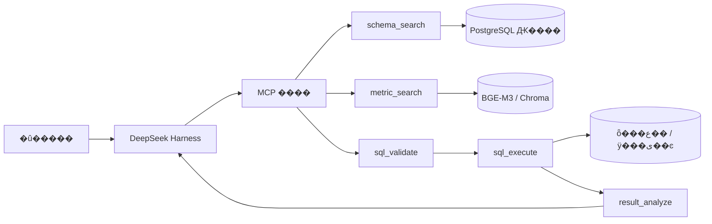

# Criteo ������ݷ��� Agent

���� Criteo ��ʵ�ع����ݹ����ı��ع�����ϵͳ����� PostgreSQL��BGE-M3��Chroma �� MCP��Ϊ DeepSeek Harness �ṩ�ֶβ�ѯ��ָ���������ȫ SQL ��ѯ��������������

��ǰ�����ѵ��� **16,468,027 ���ع��¼��675 �� campaign**������ **31 �����������**��ÿ�ռƻ��ﻯ��ͼ���� **20,665 ��**����Ŀ�ĵ�ͳһά���ڱ� README��

## ������ܹ�

- ÿ������ 100,000 �У�ͨ�� COPY �����м����У�����������������滻ԭʼ����ˢ���ﻯ��ͼ��
- ʹ�ö�����ժҪ�˶���Դ���м�������ձ���ȫ�� 23 �м����򣻱���ԭ 20 �����������ݡ�
- �������ֶδ� PostgreSQL ʵʱԪ���ݻ�ȡ��ָ�궨����ҵ������� BGE-M3 / Chroma ������
- SQLGlot У�鵥�� SELECT�������������ֶΡ������� LIMIT������ֻ���˺�ִ�в�ѯ��������Դ��
- ��ѯ����Խṹ����¼�Ϳ����õ������ķ��ظ� Agent��



## Ŀ¼

```text
.
������ ad_agent/                    # MCP ����Ŀ¼��ѯ��SQL У����ִ��
��   ������ mcp_server.py
��   ������ catalog.py
��   ������ tools.py
��   ������ sql_policy.py
��   ������ sql_tools.py
��   ������ harness-mcp.patch.yml     # �»����� MCP ����ʾ��
������ database/                    # ���������롢���ݿ���������֤
��   ������ schema.sql
��   ������ views.sql
��   ������ db.py
��   ������ readonly.py
��   ������ setup_postgres.py
��   ������ setup_readonly.py
��   ������ import_sample.py
��   ������ import_full.py
��   ������ verify_full.py
��   ������ postgres_paths.py
��   ������ Start-Postgres.ps1
��   ������ Stop-Postgres.ps1
������ knowledge/                   # �ֶΡ�ָ�꼰ҵ�����
��   ������ table_schema.md
��   ������ metric_definitions.md
��   ������ business_rules.md
��   ������ dataset_manifest.json
������ rag/                         # ģ�����ء��ֿ顢����ͼ���
��   ������ download_model.py
��   ������ embedding.py
��   ������ chunks.py
��   ������ metadata.py
��   ������ store.py
��   ������ build_index.py
��   ������ retrieve.py
��   ������ settings.py
������ data/
��   ������ raw/                     # ԭʼ TSV.gz�����ر���
��   ������ interim/                 # ǰ 20 ������������ Parquet
��   ������ processed/               # ȫ��ÿ�ռƻ�ͳ�� Parquet
������ tests/                       # SQL ��ȫ��MCP Э��ͻ�׼����
������ Set-ProjectEnv.ps1
������ Start-Harness.ps1
������ requirements.txt
������ requirements.lock.txt
������ README.md
```

��������Ŀ¼ `.venv/`��`.runtime/`��`.cache/`��`.tmp/`��`.dsh/` �����ݿ� `pgdata/` ���ύ Git��ģ��Ȩ�ء�ԭʼ���ݡ����� Parquet �� Chroma ����Ҳ����Դ���ϴ���

## ������ͳ�ƿھ�

��Դ��[Criteo �ٷ�����](https://ailab.criteo.com/criteo-attribution-modeling-bidding-dataset/)��[Criteo �ٷ� Hugging Face �ֿ�](https://huggingface.co/datasets/criteo/criteo-attribution-dataset)��

ԭʼ�ļ�Ϊ `data/raw/criteo_attribution_dataset.tsv.gz`��������ͷ�� 22 ���ֶΣ�ѹ����СΪ 653,015,824 �ֽڡ�SHA-256��

```text
94ac7a465564349bc7ba008602211d5990a3c53cc133abc0aadef61ea2391a98
```

��������Ϊ [CC BY-NC-SA 4.0](https://creativecommons.org/licenses/by-nc-sa/4.0/)��ʹ�úͷַ�����ʱӦ���عٷ�������ֿⲻ����ԭʼ���ݻ�ģ��Ȩ�ء�

| ���� | ���� |
| --- | --- |
| `public.raw_criteo_impression` | ȫ���ع����22 ��ԭʼ�ֶ��뱾�����ɵ� `row_id`���� 23 �С� |
| `public.ads_campaign_daily` | �� `data_day` �� `campaign_id` �ۺϵ��ﻯ��ͼ���� 8 �С� |
| `criteo_sample.parquet` | ������ǰ 200,000 ��˳�򿪷���������������ǰ���ݿⷶΧ�� |
| `campaign_daily.parquet` | ȫ��ÿ�ռƻ�ͳ�ƣ��������պͼƻ����� |

�ؼ�Լ����

- һ�д���һ���ع⡣`campaign` ��ԭʼ���ƻ� ID����ͼ�е� `campaign_id` ���������
- `click` �� 0/1 ��ǣ������Ϊ `SUM(click)`��CTR Ϊ `SUM(click)::NUMERIC / NULLIF(COUNT(*),0)`��
- `conversion=1` ��ʾ�ع�� 30 ���ڴ���ת��������ת��������� `conversion_id<>-1` ��ȥ�أ����ܽ������ع�������������������
- ����ת������������ `attribution=1`�����ջ��ƻ���ȥ��ת��������ֱ���ۼӡ�
- `cost`��`cpo` ��ת�������ֵ��������ʵ���ҽ�ȱ�������ֶΣ��޷�������ʵ ROAS��
- `cat1`�C`cat9` �������������������������ҵ����δ������
- `timestamp` Ϊ���������`data_day=FLOOR(timestamp/86400.0)::INTEGER+1`������ת��Ϊ��ʵ�������ڡ�
- ��ǰʱ�䷶ΧΪ 0�C2,671,199 �룬��Ӧ��������� 1�C31����������족����������ͣ���ǰ��Ӧ 25�C31��

�ֶ���ϸ��ָ�깫ʽ�Ͳ�ѯ�߽�ֱ�� [table_schema.md](knowledge/table_schema.md)��[metric_definitions.md](knowledge/metric_definitions.md)��[business_rules.md](knowledge/business_rules.md)��

## ���ػ���

��ǰ����ʹ�� Windows x64��Python 3.11��Node.js 26��PostgreSQL 18.7�������汾�� [requirements.txt](requirements.txt) �� [requirements.lock.txt](requirements.lock.txt)��

���нű�Լ�����±���Ŀ¼���»�����Ҫ���а�װ�������Ӧ����ʱ��

```text
.runtime/python311/python.exe
.runtime/nodejs/node.exe
.runtime/nodejs/npx.cmd
.runtime/postgresql/pgsql/bin/
.runtime/postgresql/pgsql/lib/
.runtime/postgresql/pgsql/share/
```

PostgreSQL �����ư��� [�ٷ� Windows �������](https://www.postgresql.org/download/windows/) ��ȡ��Windows ����·�������� `database/postgres_paths.py` ����ʱ ASCII �̷�ӳ�䴦�����ļ��Դ������ĿĿ¼����ע��ϵͳ����

����Ŀ��Ŀ¼�� PowerShell��

```powershell
# �»����״δ������⻷�������л��������ظ�������
& '.\.runtime\python311\python.exe' -m venv .venv
. '.\Set-ProjectEnv.ps1'
python -m pip install -r requirements.txt
```

`Set-ProjectEnv.ps1` ���õ�ǰ�ն˵� Python��Node.js��PostgreSQL ·������Ŀ�ڻ��桢��ʱĿ¼�� Harness home��ֱ����װ lock �ļ�ʱ��CPU PyTorch �����ָ�� `--extra-index-url https://download.pytorch.org/whl/cpu`��

### �״�׼�����ݿ�

1. �ӹٷ���Դ����ԭʼ���ݣ��������ļ������� `data/raw/`��
2. ִ�� `python database/setup_postgres.py`���������ؼ�Ⱥ�������˺ź� `criteo_ads` ���ݿ⡣
3. ִ�� `python database/import_sample.py`����֤ǰ 20 �����ܵ�������ԭʼ����
4. ʹ�õ����˺�ִ�� `database/views.sql`������ÿ�ռƻ��ﻯ��ͼ��
5. ִ�� `python database/setup_readonly.py`������������ `criteo_reader` �˺š�
6. ִ�� `python database/import_full.py`�����ȫ�����룻Ȼ������ `python database/verify_full.py`��

����ȫ��������Ҫ����ִ��������ʼ����Ҳ��Ҫ�ٴ�׷���������ݡ�

�����˺���ֻ���˺ŵ����ƾ�ݷֱ𱣴��� `database/connection.json`��`database/readonly_connection.json`������Աƾ��λ�� `database/.secrets/`�������ύ�汾������Python ����ͳһͨ�� `database/db.py` �� `database/readonly.py` ���� SQLAlchemy engine��

ȫ����������Ϊ����Դ SHA-256 �� gzip ��� �� 10 ���з�����֤/COPY �� �м��ȫ�ֶ�ժҪ�˶� �� ���ݾ����� �� �������滻ԭ����ˢ����ͼ �� ���� Parquet������ԭ������ͼ�Ķ������ݡ�������ֻ����Ȩ��CTR У����� `ROUND_HALF_UP`���� PostgreSQL �������һ�¡�

����������ֹͣ��

```powershell
. '.\Set-ProjectEnv.ps1'
& '.\database\Start-Postgres.ps1'
& '.\Start-Harness.ps1'
# ֹͣ���ݿ�ǰ�Ƚ�������ִ�еIJ�ѯ��
& '.\database\Stop-Postgres.ps1'
```

ȫ������֧���ڷ���ʧ�ܺ�������֤�м����`python database/import_full.py --resume-validated`����ѡ��Ҫ������Ӧ����״̬���м�������������������ɵ��롣

## RAG ����

��������������֪ʶ Markdown�����ùٷ� `BAAI/bge-m3` �� 1024 ά��һ������������ Chroma ���Ҽ�������ǰʹ�� CPU��ģ��λ�� `.runtime/models/bge-m3/`�����ذ汾���ļ�У���¼�� [model_manifest.json](rag/model_manifest.json)��

```powershell
. '.\Set-ProjectEnv.ps1'
python -m rag.download_model
python -m rag.build_index
python -m rag.retrieve 'CTR ��ʲô��ʹ���ĸ��ֶμ��㣿'
```

��ǰ����Ϊ 23 ��֪ʶ�飬����Դ�ļ����½ں��кš����������� `rag/chroma/`��`rag/index_manifest.json` ��¼�ĵ���ϣ��֪ʶ�ĵ��޸ĺ�����ؽ�������������ܾ�ʹ�ù����ĵ��汾��

���ṹ��ʵʱ PostgreSQL Ԫ����Ϊ׼������������ƥ��²��ֶΡ������������ `knowledge`��`database_metadata` �� `agent_context`��Embedding �ڱ������У���������������ģ�͡�

## MCP ����

ͳһ��ڣ�[ad_agent/mcp_server.py](ad_agent/mcp_server.py)��

| ���� | ʵ�� | ��������; |
| --- | --- | --- |
| `schema_search` | `catalog.py` | `query`����ѡ `table_name`����ѯ `information_schema.columns`���ﻯ��ͼ���� `pg_catalog`�� |
| `metric_search` | `tools.py` | `query`��`top_k=3`������ָ���ҵ�����`top_k` ��Χ 1�C5�� |
| `sql_validate` | `sql_policy.py` | `sql`��SQLGlot AST У�鼰�淶���� |
| `sql_execute` | `sql_tools.py` | `sql`��ʵʱ����У���ʹ��ֻ���˺Ų�ѯ��������ʵ `rows` �� `result_id`�� |
| `result_analyze` | `sql_tools.py` | `result_id`��`preview_rows=20`��������ʵ����������ժҪ�� `agent_context`��Ԥ������ 100 �С� |

��ȫ���ƣ�

- ������������Ŀ����ĵ��� SELECT��֧�����޵� CTE���Ӳ�ѯ�뼯�����㡣
- ʵʱ��֤�����ֶμ������������ͱ������Ͳ��ð�������
- �ܾ�д������DDL������䡢`SELECT INTO`���������ݹ� CTE��Σ�պ������Զ����������
- ����������ʽ�������� `LIMIT 1�C1000`�����ܽ����Ӳ�ѯ�����ơ�
- `criteo_reader` �ޱ�д�롢��������ʱ��������д������Ȩ�ޣ�ÿ��ִ�о�ʹ��ֻ������
- ��ѯ��ʱ 5 �룬���ȴ���ʱ 1 �룬������� 1000 ��/1 MB��
- `NUMERIC` ��ʮ�����ַ������أ����⾫����ʧ��˫������ֵ�� JSON ��ֵ���ء�
- �������λ�� `.tmp/sql_results/`����ౣ�� 32 �ݣ����� 24 Сʱ�Ľ�������²�ѯ��

����˳��Ϊ�ֶ�/ָ����� �� SQL У�� �� ִ�� �� ʹ����ʵ��� ID �����������ع⡢�����CTR ��ת���ɱ����Ȳ�ѯÿ���ﻯ��ͼ���������ת��������Ŀ��ԭʼ��¼��Χ����ȥ�ء�

### ���� Harness

[����ʾ��](ad_agent/harness-mcp.patch.yml) ʹ��ģ�鷽ʽ������

```text
python -u -m ad_agent.mcp_server
```

��ʾ���е� `D:\Projects\ad-data-agent` �滻Ϊʵ����Ŀ��Ŀ¼�������õ����� `.dsh/profiles/web/cordis.patch.yml` ������ `mcp-manager` ��Ŀ����Ҫ�ظ�����ͬ����Ŀ���滻 `servers` ӳ��ʱӦ�������з���������ǰ��������Ч���������޸ġ�

Harness ��������ʹ�� `mcp__ads_knowledge__` ǰ׺�����ߴ�����������º󣬿�������Ӧ MCP ���ӣ��������г����߲����������ģ�ͣ�Embedding ������ز��ڽ����ڸ��á�

ʾ����ѯ��

```sql
SELECT campaign_id,
       SUM(impressions) AS impressions,
       SUM(clicks) AS clicks,
       ROUND(SUM(clicks)::NUMERIC / NULLIF(SUM(impressions), 0), 6) AS ctr
FROM public.ads_campaign_daily
GROUP BY campaign_id
ORDER BY impressions DESC, campaign_id
LIMIT 10;
```

## ����������

```powershell
. '.\Set-ProjectEnv.ps1'
python tests/test_sql_tools.py
python tests/test_rag_acceptance.py
python database/verify_full.py
```

���ز��Ը���ֻ��Ȩ�ޡ�35 ��Σ�� SQL���ֶβ����ڡ�CTE/�������á������������С���ơ���ʵ���ݿⳬʱ���Լ��幤�� MCP ���������������ݼ�黹����Դ�ļ�/���ݿ�ժҪ����������ǰ׺�����ݡ�Parquet ������߸������յĶ����Աȡ�

30 ���׼�� 20 ����ѯ��4 ��ָ��/ʱ�䶨�塢4 ����֧�������2 ����ȫ�ܾ�����ɡ���Ŀ���׼�� [agent_questions.json](tests/agent_questions.json)��[agent_benchmark_cases.py](tests/agent_benchmark_cases.py)��

�״�����ʹ��ǰ 200,000 �������������������� SQL�������������жԱȲο�����ķ�ʽ������һ���� Harness ��ʾ����������������ͬ�� 30 �ζ����˵��˻Ự��

| ָ�� | ��ʷ������� |
| --- | --- |
| SQL ִ�гɹ��� | 20/20 |
| SQL ��ѯ���׼ȷ�� | 20/20 |
| ָ�궨��׼ȷ�� | 2/3 |
| ���ݿⰲȫ������ | 35/35 |
| ��֧������ʶ���� | 4/4 |
| ��֧��������ʵ�� | 3/4 |

���ֵ�����������������ʽ��© NUMERIC ת������������������δ��������������������������Ϊ��Ʒ��Ŀ��ȫ������͹��ߺ�������ɣ���ʷģ������ɼ�����Ϊȫ��ģ��������ۡ�ժҪ�� [evaluation_summary.json](tests/evaluation_summary.json)��

׼���ο�������������лش�

```powershell
python tests/agent_benchmark_cases.py
python tests/evaluate_agent.py --reference-only
# ����ʵ�ش𱣴�Ϊ tests/agent_answers.json ��ִ�У�
python tests/evaluate_agent.py
```

����Ƚ�ȫ��֧�ֲ�ѯ����������˳�������ֵ��ִ��ʧ��Ҳ�����ĸ�������� ID ��ȷ�Ƚϣ��������� 0.000001 �ݲת���ɱ�����������������帴�˼�¼��ش��ϣ�󶨣��������õ���ͬ�ش𡣵�ǰδ���½���ȫ������ģ�����⡣

��ϸ����/���鱨�桢ģ��ԭʼ�ش𡢲ο������������־�����ڱ��أ����ύ Git��������Ӧ�ű���������Щ���

## ʵ������

| �׶� | �������� | �������� |
| --- | --- | --- |
| ��ȡ���� | ���ز�У�鹫�� Criteo ���� | ����� / VS Code |
| �������ݿ� | PostgreSQL �����������ÿ�վۺ� | VS Code / PostgreSQL |
| ׼��֪ʶ | �ֶ��ֵ䡢ָ�깫ʽ��ҵ����� | VS Code |
| ���� RAG | Markdown �ֿ顢BGE-M3 ���롢Chroma ���� | Python |
| �������� | Ԫ���ݡ�ָ�ꡢSQL ��ȫ��ִ�кͷ��� | Python / MCP |
| ���� Harness | ���� stdio MCP ���� Agent ���� | DeepSeek Harness |
| ��֤ Agent | ��ʵ�ֶ����⡢��׼ SQL �ȶ���ܾ�ʶ�� | Harness / ���ز��� |
| �������� | Դ�롢�ĵ�������ժҪ�������嵥 | GitHub |
